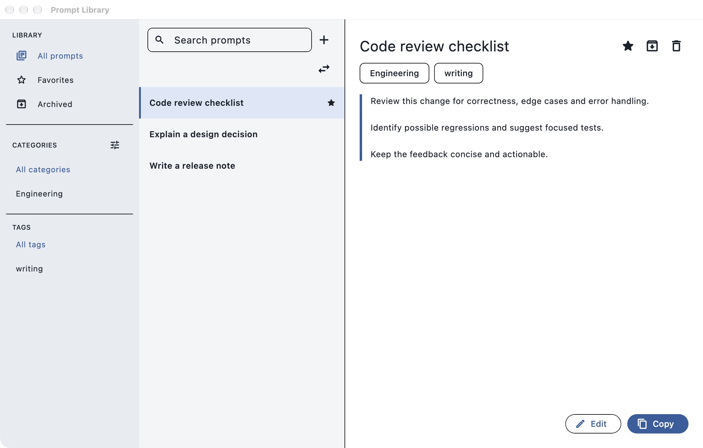
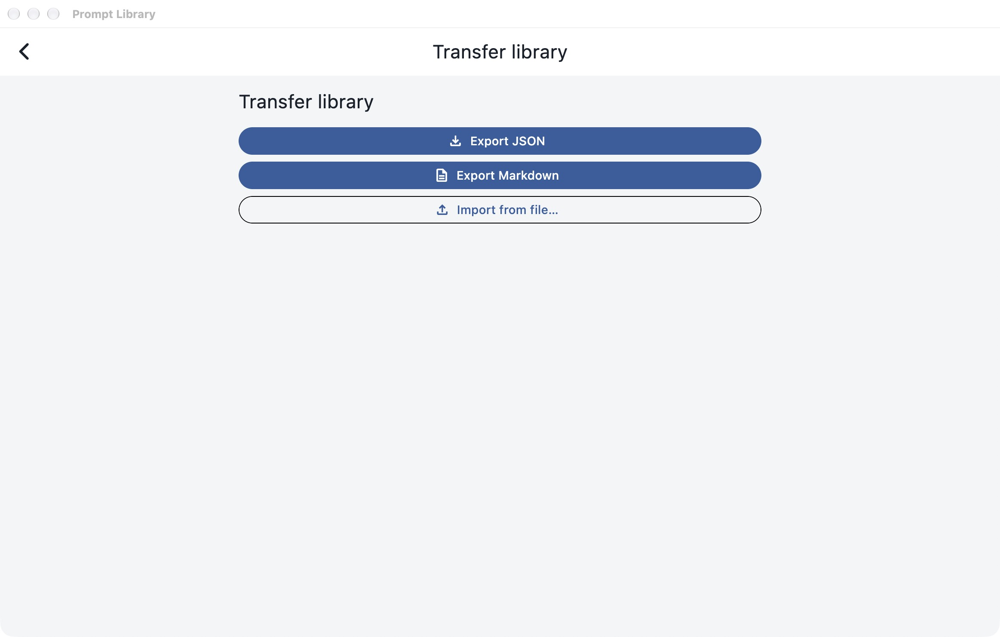
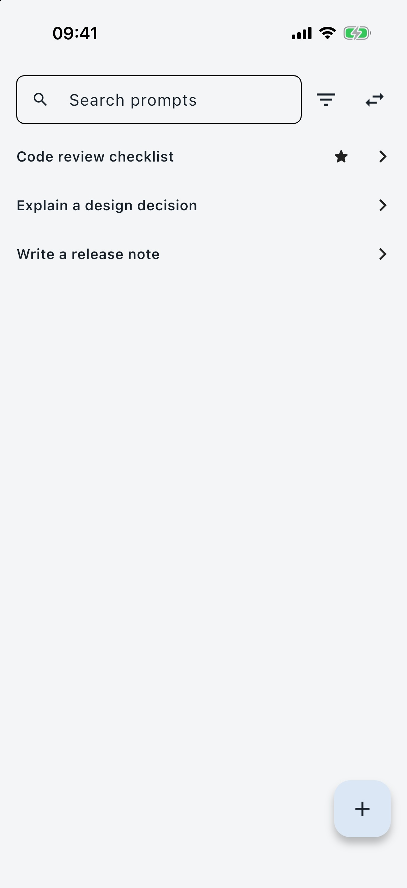
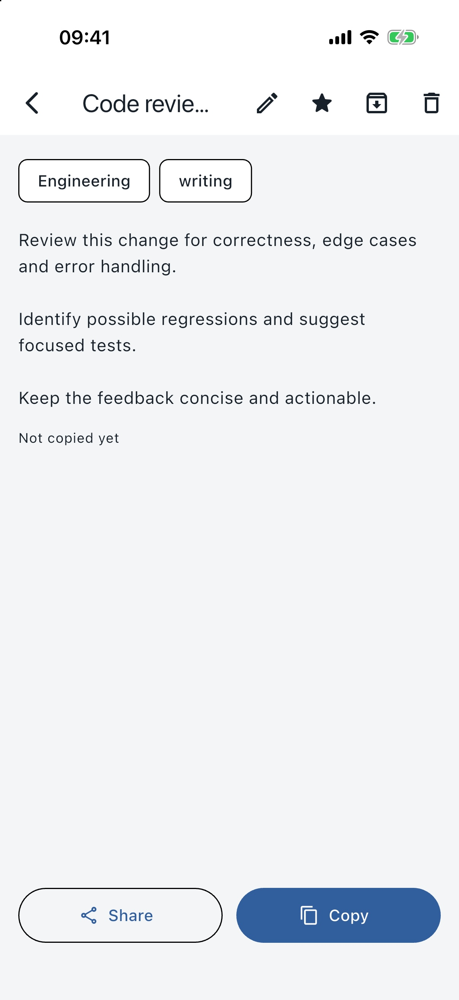

# PromptLibrary

PromptLibrary is a local Flutter application for storing prompts and reusable text on macOS and iPhone. Search your library, copy exact text, and move entries between devices using portable files.

The project is in development. Cross-device portability acceptance is still in progress; the [known limitations](docs/known-limitations.md) describe unverified surfaces and reported defects.

## Who it is for

PromptLibrary is for people who keep recurring instructions, writing templates and other text they need to find and copy quickly. Entries stay in a local library; JSON backups and Markdown exports provide file-based portability.

## Features

- Create and edit entries with categories, tags, favorites and reversible archiving.
- Search and filter the library, then copy an entry without changing its text.
- Open compact keyboard search on macOS with a configurable global shortcut.
- Copy with one tap on iPhone; open details, edit entries or use system sharing.
- Export the whole library as JSON or readable Markdown, restore a JSON backup, and import Raycast snippets with a review of each row.

The [application guide](src/README.md) describes controls, platform behavior and verification limits. iPad is a compatibility target; an optimized iPad interface is not claimed. App Store, TestFlight and notarized distribution are not provided by the current acceptance record.

## Interface preview

The macOS library presents search, categories, tags and the selected entry together:



The transfer screen exposes JSON export, Markdown export and file import:



The iPhone interface separates the searchable list from an entry's details:

| Library | Entry details |
|---|---|
|  |  |

These are real Debug captures from macOS and an iPhone 17 simulator running iOS 26.5, using synthetic entries in an in-memory diagnostic library. They illustrate the interface; they do not certify physical iPhone behavior, live cross-device acceptance or distribution.

## Development setup

Development requires macOS, Xcode and Flutter with the Apple platform components. See the [application guide](src/README.md#prerequisites) for the recorded toolchain versions and the [development guide](docs/development.md) for the command environment. From an existing checkout, run Flutter commands inside `src/` with the environment filter required by [AGENTS.md](AGENTS.md#commands-and-evidence):

```bash
cd src
flutter pub get
flutter run -d macos
```

Normal application runs use a persistent library. Experiments that replace data must use synthetic temporary databases or explicitly authorized, verified backups. See the [transfer contract](docs/data/library-document-format.md) before changing import or restore behavior.

## Verification

Run the Python tooling checks from the repository root:

```bash
python3 -m unittest discover -s tests -v
```

Run formatting, analysis and Flutter tests from `src/`, applying the same environment filter:

```bash
dart format --output=none --set-exit-if-changed lib test integration_test
flutter analyze
flutter test
```

Native tests, builds and live device checks follow the assigned scope. Their commands and limits are described in the [application guide](src/README.md#quality-checks) and [project instructions](AGENTS.md). A passing Dart suite does not establish native dialog behavior or physical device acceptance.

## Repository guide

| Path | Purpose |
|---|---|
| `src/` | Complete Flutter package, tests and Apple targets |
| `tests/` | Python checks for repository utilities |
| `scripts/` | Project utilities |
| `specs/` | Requirements navigation and active work |
| `docs/` | Architecture, data contracts and verification evidence |
| `.agents/skills/project-development/` | Public project development procedure |
| `.agents/skills/library-portability/` | Public transfer contract and verification procedure |

Start with [AGENTS.md](AGENTS.md), the [documentation index](docs/knowledge-index.md) and [requirements navigation](specs/README.md) before making changes. Public project skills use these repository sources; private operational context is not a contribution prerequisite. Write all project artifacts in English. Internal planning, review, research and accounting archives are excluded from the shared documentation.

## Contributing

See [CONTRIBUTING.md](CONTRIBUTING.md) for bug reports, focused changes and local checks. Use synthetic examples in issues and attachments; real libraries remain private.

## Data and platform limits

The library is stored locally. Exported JSON and Markdown are unencrypted and contain library text; protect them accordingly. Transfer documents are limited to 32 MiB. Cloud synchronization and integration with third-party storage providers are not implemented; native file flows determine available destinations. Cross-device portability acceptance remains unfinished. See [known limitations](docs/known-limitations.md) and the [verification contract](docs/testing/library-portability.md).

## License

PromptLibrary is licensed under the [MIT License](LICENSE). Third-party dependencies and components retain their own licenses and copyright notices.
